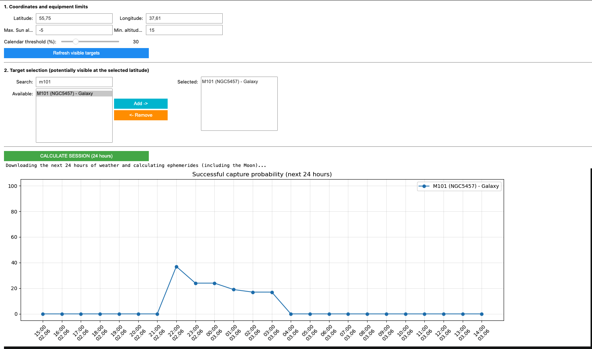
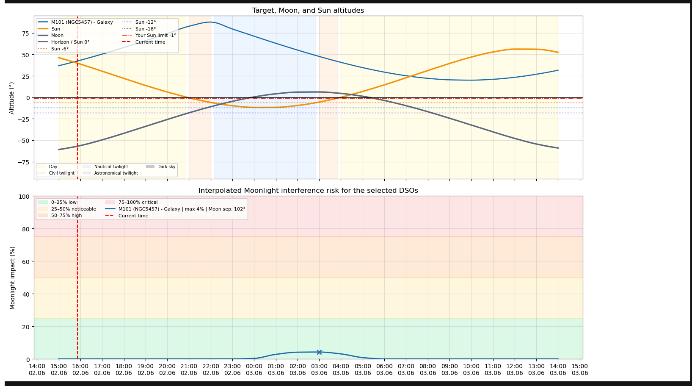
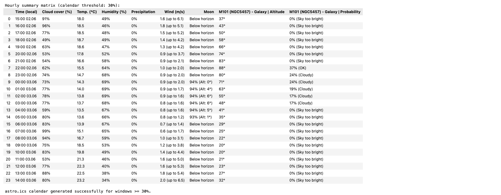
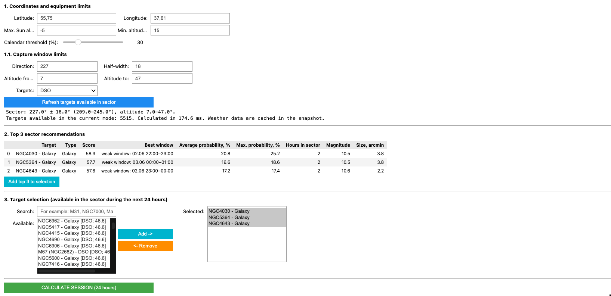
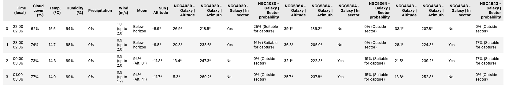

# 🌌 Astro Planner V2 — Jupyter Notebook Astrophotography Planner

[](https://www.python.org/)
[](https://jupyter.org/)
[](https://rhodesmill.org/skyfield/)
[](#-use-cases--target-audience)
[-yellow.svg)](LICENSE)

> 🌐 **Language / Язык:** [English](#english) | [Русский](#русский)

---

<a name="english"></a>
# English

**Astro Planner V2** is an interactive **Jupyter Notebook** (`.ipynb`) application powered by `ipywidgets` for planning astrophotography sessions and visual observations under **restricted horizon conditions** (narrow balconies, urban windows, backyards obstructed by buildings or trees).

Unlike traditional planetarium software that assumes an unobstructed 360° open sky, Astro Planner implements a **"Window-First" planning strategy**: define your physical view corridor (azimuth and altitude limits), and the algorithm automatically surfaces the best targets transiting your window during clear, dark hours.

Available in two notebooks:
- 🇬🇧 **English version:** [`astro_planner_sector_EN.ipynb`](astro_planner_sector_EN.ipynb)
- 🇷🇺 **Russian version:** [`astro_planner_sector_RU.ipynb`](astro_planner_sector_RU.ipynb)

---

## 📚 Articles & Background

The methodology and design principles behind this planner are detailed in the author's publications:

* 📖 **Medium:** [**Planning Better Astrophotography Sessions When Your View of the Sky Is Limited**](https://medium.com/@urban-materials/planning-better-astrophotography-sessions-when-your-view-of-the-sky-is-limited-8355c152ff93?sharedUserId=urban-materials) — in-depth guide on the "picket-fence" strategy, micro-windows, and transit timing.
* 💬 **Reddit (r/seestar):** [**Discussion on r/seestar: Planning sessions with limited sky view**](https://www.reddit.com/r/seestar/s/Kq09PaTnwX) — real-world discussion with smart telescope owners.

---

## 🎯 Use Cases & Target Audience

* **Smart Telescope Users (ZWO Seestar S50, Dwarf II/III, Vaonis Vespera):** Quickly identify which deep-sky objects or planets enter your open sector without manual trial and error.
* **Balcony & Urban Astrophotographers:** Overcome narrow corridors between neighboring houses, roofs, and urban light pollution.
* **Mobile & Backyard Observers:** Optimize multi-night imaging projects by catching objects during peak culmination within your clearest corridor.

---

## 📸 Interface Screenshots

### 1. Coordinates, Equipment Limits & Target Selection


### 2. Trajectories, Twilight Phases & Moon Light Pollution Chart


### 3. Hourly Summary Scoring Matrix


### 4. Sector Window Planner (Balcony / Window) & Top 3 Recommendations



---

## ✨ Key Features

1. **High-Precision Astronomy (NASA JPL DE421 Ephemeris):**
   - Bundles the official NASA JPL `de421.bsp` ephemeris file (16.8 MB) directly in the repository for fast, 100% offline calculations.
   - High-precision positions for the Sun, Moon, Solar System planets, and stellar targets via Skyfield.

2. **Offline OpenNGC Database (~13,000 Objects):**
   - Pre-packaged decoded database `NGC_full_decoded.csv` (galaxies, nebulae, open/globular clusters, Messier catalog).
   - Fast filtering by object type and automatic exclusion of non-rising targets for your latitude.

3. **Live Weather Integration (Open-Meteo, No API Key Required):**
   - Free automated 24–48 hour forecast: cloud cover by layers (low, mid, high), precipitation probability, temperature, humidity, wind speed, and gusts.

4. **Moon Interference & Twilight Modeling:**
   - Full twilight detection: civil (-6°), nautical (-12°), astronomical (-18°), and true dark sky.
   - Calculates Moon angular separation, lunar phase, and Moon altitude with realistic quality penalties for deep-sky objects.

5. **"Window-First" Sector Planner:**
   - Configure your viewing slot: Azimuth direction (e.g., 281° West), half-width (±10°), altitude limits (e.g., 15°–55°).
   - Automatically filters targets that transit or culminate inside your specific window.

6. **Automated Top 3 Recommendations:**
   - Evaluates all visible objects and ranks the top 3 best targets based on dwell time inside the window, peak altitude, cloud forecast, and dark sky quality.

7. **iCalendar (`.ics`) Export:**
   - Exports high-probability observing windows into an `astro.ics` file for Google Calendar, Apple Calendar, or Outlook with reminder notifications.

---

## 🚀 Quick Start & Installation

### 1. Clone the repository
```bash
git clone https://github.com/mapboxer/backyard-astro-planner.git
cd backyard-astro-planner
```

### 2. Create and activate a Python virtual environment
**macOS / Linux:**
```bash
python3 -m venv .venv
source .venv/bin/activate
```

**Windows (PowerShell):**
```powershell
python -m venv .venv
.\.venv\Scripts\Activate.ps1
```

### 3. Install dependencies
```bash
pip install --upgrade pip
pip install -r requirements.txt
```

### 4. Launch Jupyter Notebook
```bash
jupyter notebook
```
Open the English version:
```bash
jupyter notebook astro_planner_sector_EN.ipynb
```
> **Tip:** In the Jupyter top menu, select `Kernel` -> `Restart & Run All` to display all interactive widgets.

---

## 📋 Repository Structure

```text
├── astro_planner_sector_EN.ipynb  # Full working notebook with English UI and sector planner
├── astro_planner_sector_RU.ipynb  # Полный рабочий ноутбук с русским интерфейсом и секторным расчетом
├── de421.bsp                      # NASA JPL DE421 ephemeris file for Skyfield
├── NGC_full_decoded.csv           # Full decoded OpenNGC database (~13,000 objects)
├── requirements.txt               # Required Python packages
├── .gitignore                     # Git ignore rules
├── LICENSE                        # MIT License with Attribution Clause
├── README.md                      # Project documentation (EN & RU)
└── img_post/                      # Interface screenshots and documentation assets
```

---

## 🛠 System Requirements

- **Python:** 3.9, 3.10, 3.11, or 3.12
- **Internet connection:** only required for the free Open-Meteo weather forecast query. All celestial calculations, ephemerides, and catalog lookups run **100% offline**.
- **Supported OS:** macOS, Windows, Linux.

---

## 🔭 Data Sources & Acknowledgments

- [Skyfield](https://rhodesmill.org/skyfield/) — Brandon Rhodes, high-precision astronomical library.
- [NASA JPL DE421](https://ssd.jpl.nasa.gov/) — Planetary and Lunar Ephemerides.
- [OpenNGC](https://github.com/mattiaverga/OpenNGC) — Deep-sky database by Mattia Verga.
- [Open-Meteo](https://open-meteo.com/) — Free, open weather forecast API.

---

## 📜 Citation & Attribution

If you use this project, its algorithms, or calculation outputs in your research, articles, videos, or derived software, **please cite the original author and repository**:

**Text Citation:**
> Denis Murataev (@mapboxer). *Backyard Astro Planner — Interactive Jupyter Astrophotography & Sector Planner* (2026). GitHub: https://github.com/mapboxer/backyard-astro-planner

**BibTeX:**
```bibtex
@software{murataev2026backyardastroplanner,
  author = {Denis Murataev},
  title = {Backyard Astro Planner: Interactive Jupyter Astrophotography & Sector Planner},
  year = {2026},
  publisher = {GitHub},
  url = {https://github.com/mapboxer/backyard-astro-planner}
}
```

---

## 📄 License

This project is licensed under the [MIT License with Mandatory Attribution Clause](LICENSE).  
Retaining the author notice (**Denis Murataev / @mapboxer**) and a link to the original repository is mandatory in all distributions and derivative works.

---
---

<a name="русский"></a>
# Русский

**Astro Planner V2** — интерактивное приложение в формате **Jupyter Notebook** (`.ipynb`) с виджетами `ipywidgets` для планирования астрофотографических сессий и визуальных наблюдений в условиях **ограниченного сектора обзора** (балкон, городское окно, двор между домами или деревьями).

В отличие от классических программ-планетариев, рассчитывающих видимость для открытого горизонта 360°, Astro Planner реализует подход **«Window-First»**: вы задаете границы вашего физического коридора обзора (азимут направления, полуширину сектора и диапазон высот), а алгоритм сам определяет, какие объекты и в какое темное время суток будут транзитировать через ваше окно.

Ноутбук доступен на двух языках:
- 🇷🇺 **Русская версия:** [`astro_planner_sector_RU.ipynb`](astro_planner_sector_RU.ipynb)
- 🇬🇧 **English version:** [`astro_planner_sector_EN.ipynb`](astro_planner_sector_EN.ipynb)

---

## 📚 Статьи и публикации автора

Методология и алгоритмические идеи проекта подробно описаны в публикациях автора:

* 📖 **Medium:** [**Planning Better Astrophotography Sessions When Your View of the Sky Is Limited**](https://medium.com/@urban-materials/planning-better-astrophotography-sessions-when-your-view-of-the-sky-is-limited-8355c152ff93?sharedUserId=urban-materials) — подробный разбор методологии съемки в узких окнах видимости («стратегия частокола», микро-окна, тайминг кульминации).
* 💬 **Reddit (r/seestar):** [**Discussion on r/seestar: Planning sessions with limited sky view**](https://www.reddit.com/r/seestar/s/Kq09PaTnwX) — обсуждение реальных кейсов планирования съемок с комьюнити владельцев смарт-телескопов.

---

## 🎯 Для кого этот инструмент / Use Cases

* **Владельцы смарт-телескопов (ZWO Seestar S50, Dwarf II/III, Vaonis Vespera и др.):** Быстрый и безошибочный подбор объектов, попадающих в открытый сектор балкона или двора.
* **Балконная и городская астрофотография:** Эффективная работа в узких коридорах застройки и в условиях городской засветки.
* **Классические сетапы с ограниченным горизонтом:** Максимальная утилизация ценных минут ясного неба без лишних перестановок оборудования.

---

## 📸 Скриншоты интерфейса

### 1. Выбор координат, параметров оборудования и объектов


### 2. График траекторий, сумерек и засветки Луной


### 3. Сводная почасовая матрица с оценкой вероятности съемки


### 4. Планировщик по сектору обзора (балкон / окно) и Топ-3 цели


---

## ✨ Основные возможности

1. **Точная астрономия (NASA JPL Ephemeris DE421):**
   - В репозиторий уже включен файл эфемерид `de421.bsp` (16.8 МБ). Приложение работает быстро и полностью автономно без обязательного скачивания эфемерид из сети.
   - Высокоточный расчет положений Солнца, Луны, всех планет Солнечной системы и звездных объектов через библиотеку Skyfield.

2. **Оффлайн-база OpenNGC (~13 000 объектов):**
   - В комплекте локальная расшифрованная база `NGC_full_decoded.csv` (галактики, туманности, рассеянные и шаровые скопления, объекты каталога Мессье).
   - Фильтрация по типам и автоматическое исключение незаходящих/невидимых на заданной широте объектов.

3. **Интеграция с погодой Open-Meteo (без API ключей):**
   - Почасовой прогноз на 24–48 часов: покрытие облаками по высотам (низкие, средние, высокие), вероятность осадков, температура, влажность, скорость ветра и порывы.

4. **Моделирование засветки и фаз Луны:**
   - Определение фаз сумерек: гражданские (-6°), навигационные (-12°), астрономические (-18°) и истинно темное небо.
   - Расчет углового расстояния между целью и Луной, фазы Луны и высоты Луны над горизонтом с плавным штрафом для объектов глубокого космоса (DSO).

5. **Секторное окно съемки (подход «Window-First»):**
   - Задание сектора обзора: азимут направления (например, 281° Запад), полуширина сектора (±10°), минимальная и максимальная высота (например, 15°–55°).
   - Фильтрация объектов, которые кульминируют или транзитируют через ваш коридор в темное время суток.

6. **Автоматические Топ-3 рекомендации:**
   - Алгоритм ранжирует цели по времени нахождения внутри сектора, максимальной высоте, качеству погоды и удаленности от засветки Луны.

7. **Экспорт в календарь (`.ics`):**
   - Автоматическая генерация файла `astro.ics` для окон съемки с вероятностью выше выбранного порога (например, 50%).
   - Легко импортируется в Google Calendar, Apple Calendar или Outlook с уведомлениями о начале сессии.

---

## 🚀 Быстрый старт

### 1. Клонирование репозитория
```bash
git clone https://github.com/mapboxer/backyard-astro-planner.git
cd backyard-astro-planner
```

### 2. Создание и активация виртуального окружения Python
**macOS / Linux:**
```bash
python3 -m venv .venv
source .venv/bin/activate
```

**Windows (PowerShell):**
```powershell
python -m venv .venv
.\.venv\Scripts\Activate.ps1
```

### 3. Установка зависимостей
```bash
pip install --upgrade pip
pip install -r requirements.txt
```

### 4. Запуск в Jupyter Notebook
```bash
jupyter notebook
```
Запуск русской версии:
```bash
jupyter notebook astro_planner_sector_RU.ipynb
```
> **Совет:** В меню Jupyter выберите `Kernel` -> `Restart & Run All`, чтобы выполнить ячейки и отобразить интерактивный интерфейс.

---

## 📋 Структура репозитория

```text
├── astro_planner_sector_RU.ipynb  # Полный рабочий ноутбук с русским интерфейсом и секторным планировщиком
├── astro_planner_sector_EN.ipynb  # Full working notebook with English UI and sector recommendations
├── de421.bsp                      # Эфемериды NASA JPL (планеты, Солнце, Луна) для библиотеки Skyfield
├── NGC_full_decoded.csv           # Полная база данных каталога OpenNGC (~13000 DSO объектов)
├── requirements.txt               # Список необходимых Python-библиотек
├── .gitignore                     # Исключение временных файлов Jupyter и кэша Python
├── LICENSE                        # Лицензия MIT с условием обязательного указания авторства
├── README.md                      # Документация проекта (EN & RU)
└── img_post/                      # Скриншоты интерфейса и демонстрационные материалы
```

---

## 🛠 Системные требования

- **Python**: 3.9, 3.10, 3.11 или 3.12
- **Интернет-соединение**: требуется только для бесплатного запроса к Open-Meteo API при расчете прогноза погоды на текущие сутки. Все астрономические расчеты и база объектов работают **полностью автономно/оффлайн**.
- **Операционная система**: macOS, Windows, Linux.

---

## 🔭 Источники данных и благодарности

- [Skyfield](https://rhodesmill.org/skyfield/) — Brandon Rhodes, астрономические вычисления высокой точности.
- [NASA JPL DE421](https://ssd.jpl.nasa.gov/) — эфемериды планет и Луны.
- [OpenNGC](https://github.com/mattiaverga/OpenNGC) — база объектов далекого космоса (Mattia Verga).
- [Open-Meteo](https://open-meteo.com/) — открытый и бесплатный API прогноза погоды.

---

## 📜 Цитирование и авторство / Citation & Attribution

Если вы используете данный проект, его алгоритмы или результаты расчетов в своих статьях, видео, исследованиях или производных проектах, **обязательно указывайте авторство и прямую ссылку на репозиторий**:

**Текстовый формат цитирования:**
> Denis Murataev (@mapboxer). *Backyard Astro Planner — Interactive Jupyter Astrophotography & Sector Planner* (2026). GitHub: https://github.com/mapboxer/backyard-astro-planner

**BibTeX:**
```bibtex
@software{murataev2026backyardastroplanner,
  author = {Denis Murataev},
  title = {Backyard Astro Planner: Interactive Jupyter Astrophotography & Sector Planner},
  year = {2026},
  publisher = {GitHub},
  url = {https://github.com/mapboxer/backyard-astro-planner}
}
```

---

## 📄 Лицензия / License

Проект распространяется под открытой лицензией [MIT с обязательным указанием авторства (Attribution Clause)](LICENSE).  
При любом использовании, модификации или распространении кода сохранение информации об авторе (**Denis Murataev / @mapboxer**) и активной ссылки на оригинальный репозиторий является **обязательным условием**.
